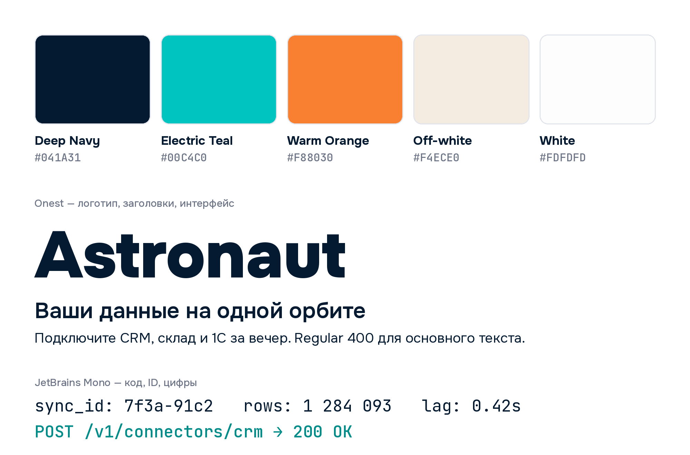

# Astronaut — шрифты и цвета



## Шрифты

### Onest — основной

Логотип, заголовки, интерфейс, тексты. Геометрический гротеск, латиница и кириллица.
Надпись «Astronaut» во всех логотипах набрана им (Black 900), слоган — SemiBold 600.

| Где | Начертание |
|---|---|
| Логотип, крупные заголовки | Black 900 |
| Заголовки | Bold 700 / ExtraBold 800 |
| Слоган, кнопки, акценты | SemiBold 600 |
| Основной текст | Regular 400 / Medium 500 |

Файл: `fonts/Onest[wght].ttf` (вариативный, 100–900).
Google Fonts: https://fonts.google.com/specimen/Onest · лицензия OFL 1.1 (`fonts/OFL-Onest.txt`).

### JetBrains Mono — моноширинный

Код, ID, ключи API, логи, цифры в таблицах — всё, что должно выравниваться по символам.
Тоже с кириллицей.

| Где | Начертание |
|---|---|
| Код, ID, логи | Regular 400 |
| Цифры в таблицах и метриках | Medium 500 |

Файл: `fonts/JetBrainsMono[wght].ttf` (вариативный, 100–800).
Google Fonts: https://fonts.google.com/specimen/JetBrains+Mono · лицензия OFL 1.1 (`fonts/OFL-JetBrainsMono.txt`).

## Цвета

| Цвет | HEX | Роль |
|---|---|---|
| Deep Navy | `#041A31` | Текст, обводки, тёмный фон. Основной цвет бренда |
| Electric Teal | `#00C4C0` | Акцент: данные, кабель, ссылки, активные состояния |
| Warm Orange | `#F88030` | Искра: CTA и точечные акценты. Использовать дозированно |
| Off-white | `#F4ECE0` | Тёплый светлый фон, подложки, тени скафандра |
| White | `#FDFDFD` | Основной светлый фон |

Пропорция на экране — примерно 60 / 25 / 10 / 5: белый и off-white фоны, navy текст,
teal акценты, orange только там, где нужно «подключение» или главное действие.

## В коде

`tokens.css` — CSS-переменные цветов и шрифтов плюс `@font-face` для локальных файлов.

`theme.ts` — тема для Mantine: шкалы по 10 оттенков `brand` (teal, основной), `accent` (orange),
`sand` (off-white), `dark` (navy для тёмной темы), шрифты. Фирменный цвет в каждой шкале
стоит на индексе 6 — его Mantine берёт для заливки, так что кнопки точно в цвет бренда.

```html
<link rel="stylesheet" href="design/tokens.css">
```

## Где используется

`brand/` — источник правды. `frontend/demo-site` подключает отсюда симлинками логотипы, иконки,
`tokens.css`, `fonts/` и `theme.ts` — правка здесь сразу видна в запущенной демке. Поэтому файлы
не переименовывайте и не перемещайте молча: ссылки сломаются (это ловит проверка стиля фронта).
Список ссылок — `frontend/demo-site/docs/codestyle/README.md`, раздел «Бренд».
