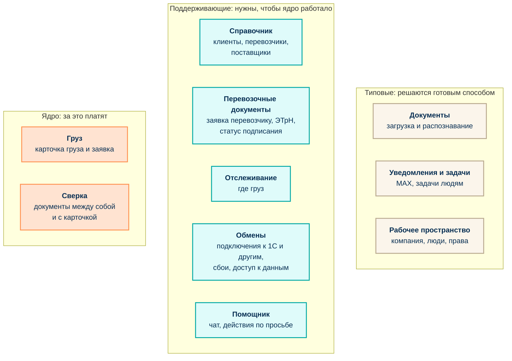
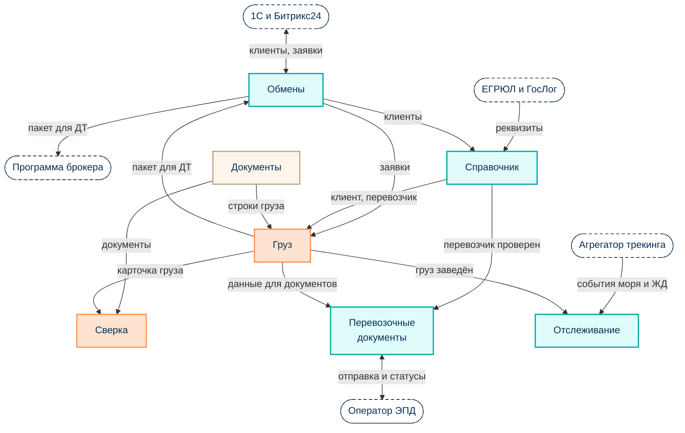
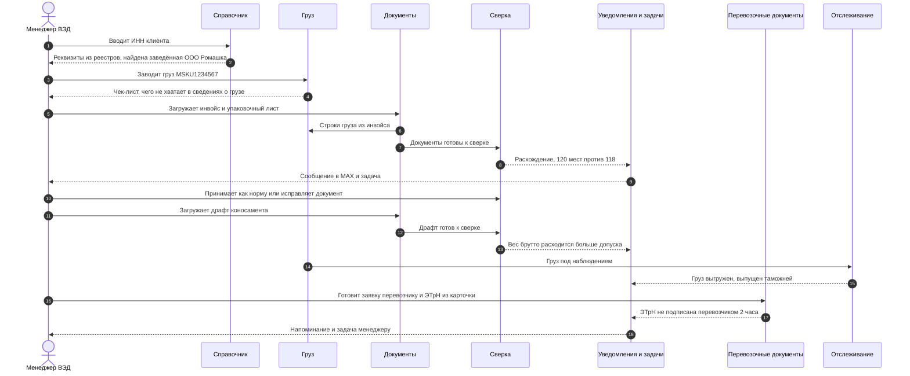
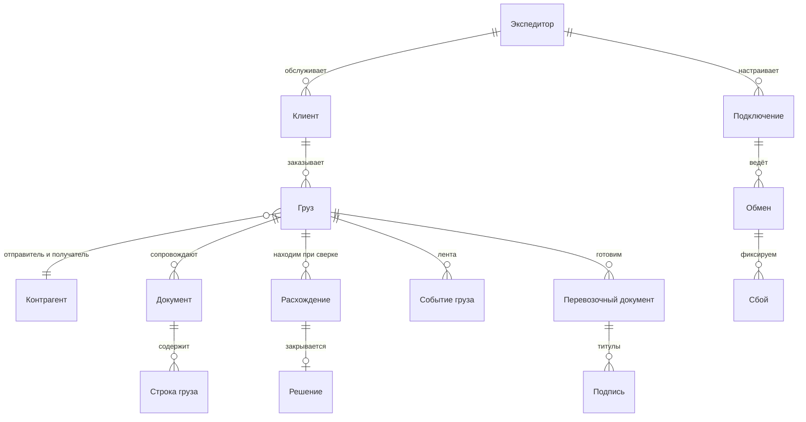

# Предметная область: контексты и связи (DDD, верхний уровень)

> [← Карта папки](../skelet/README.md) · [Юзкейсы MVP](mvp-usecases.md) · [Обещания](mvp-promises.md) · [Слои продукта](../skelet/product/layers.md) · [Логистика по шагам](../skelet/product/logistics-flow.md) · [Словарь](../skelet/glossary/terms.md)

Дата: 2026-11-04. **Черновик, это мои предложения, не решения.** Схемы для бизнеса: без технических подробностей, на русском, по юзкейсам из [mvp-usecases.md](mvp-usecases.md). Схемы в mermaid, открываются в GitHub и в большинстве редакторов.

[Слои продукта](../skelet/product/layers.md) отвечают на вопрос «из каких технических частей собрана платформа». Контексты ниже отвечают на другой: «какие области бизнеса в ней живут и кто за что отвечает». Один контекст может опираться на несколько слоёв.

**Разделы:** [Что важнее всего](#что-важнее-всего-карта-областей) · [Как области связаны](#как-области-связаны) · [Один контейнер через все области](#один-контейнер-через-все-области) · [Главные объекты](#главные-объекты) · [Карточки контекстов](#карточки-контекстов) · [Язык: что надо решить](#язык-что-надо-решить)

## Что важнее всего: карта областей

Десять областей. **Ядро** — то, за что нас покупают и что нельзя отдать на сторону. **Поддерживающие** — нужны, чтобы ядро работало, но отличием не являются. **Типовые** — решаются готовым способом.

Картинка: [1-karta-oblastey.png](ddd-images/1-karta-oblastey.png).

Почему так. Отличие продукта на рынке — сверка по одной карточке груза ([differentiators.md](../skelet/product/differentiators.md)), поэтому в ядре только две области. Распознавание и уведомления нужны, но сами по себе клиент за них не выбирает нас (гипотеза). Трекинг и обмены я отнёс к поддерживающим: трекинг вошёл в MVP по решению автора, но за ним нет уникальных правил, это лента событий от агрегатора.

## Как области связаны

Стрелка идёт от той области, которая отдаёт данные, к той, что их получает. Цвета те же, что на карте выше: оранжевый — ядро, бирюзовый — поддерживающие, кремовый — типовые, пунктирная рамка — внешние системы.

Три области на схему не вынесены, иначе она превращается в клубок: они связаны почти со всеми. **Помощник** читает все области и меняет данные только после подтверждения человека. **Уведомления и задачи** получают сообщения от Сверки, Перевозочных документов, Обменов и Отслеживания и отправляют их в MAX. **Рабочее пространство** определяет, чьи это данные и что кому можно, в том числе помощнику.

Картинка: [2-svyazi-oblastey.png](ddd-images/2-svyazi-oblastey.png).

Правила на стыках (простыми словами):
- **Внешние системы никогда не диктуют нам модель.** Каждая внешняя система подключена через «переводчика»: ЕГРЮЛ — в Справочнике, оператор ЭПД — в Перевозочных документах, агрегатор — в Отслеживании, 1С — в Обменах. Если оператор поменяет формат, меняется только переводчик.
- **Оператор ЭПД диктует формат документов, мы подстраиваемся.** Здесь мы не выбираем.
- **Документы → Сверка.** Область Документов отдаёт Сверке то, что нужно ей. Если Сверке нужно поле, которого нет, просим Документы, а не лезем в их хранилище.
- **Общий словарь на всех: номер контейнера, номер коносамента, ИНН.** По ним области находят один и тот же груз.
- **Уведомления никому ничего не диктуют.** Другие области сообщают «случилось X», а Уведомления решают, кому и куда написать.

## Один контейнер через все области

Путь контейнера MSKU1234567 с лендинга, по областям. Это тот же сквозной пример, который мы показываем клиенту.

Картинка: [3-put-konteynera.png](ddd-images/3-put-konteynera.png).

На схеме нет подключений и помощника: они работают фоном. Подключения к 1С настраивают один раз до этого пути, помощник отвечает на любом шаге.

## Главные объекты

Что именно хранит система, на языке бизнеса. Слова в кавычках — предложения для общего языка (см. [ниже](#язык-что-надо-решить)).

Картинка: [4-glavnye-obekty.png](ddd-images/4-glavnye-obekty.png).

Что здесь главное:
- **Груз** — центр всего. К нему привязано почти всё остальное; это то, что менеджер называет «карточка».
- **Расхождение** — то, ради чего покупают продукт. У него всегда есть история: найдено, кому назначено, чем закрыто.
- **Контрагент** живёт в одном месте (Справочник), остальные области ссылаются на него, а не копируют.
- **Подпись** мы не создаём и не храним, а только следим за статусом: подписывает человек в кабинете оператора.

## Карточки контекстов

Для каждой области: зачем она нужна, чем владеет, о чём сообщает остальным.

| Область | Зачем (по-бизнесу) | Чем владеет | О чём сообщает другим | Юзкейсы | Тип |
|---|---|---|---|---|---|
| **Груз** | Один раз ввести сведения о грузе и не переписывать их дальше | карточка груза, заявка, чек-лист обязательных сведений | груз заведён, карточка готова | 3 | ядро |
| **Сверка** | Найти расхождение до того, как оно станет штрафом или задержкой | правила сверки и допуски, расхождения, решения по ним | расхождение найдено, расхождение закрыто, комплект сверен | 4, 5, 6, 12 | ядро |
| **Справочник** | Один клиент, один перевозчик, один поставщик во всех документах | золотая запись, дубли, проверки по реестрам | клиент заведён, найден дубль, реквизиты изменены | 2 | поддерживающая |
| **Перевозочные документы** | Заявка перевозчику и ЭТрН из той же карточки; видно, кто не подписал | документы ЭПД, статус подписания, отклонения | отправлен на подпись, подписан, отклонён | 7 | поддерживающая |
| **Отслеживание** | Ответ на «где контейнер» без звонка | лента событий по грузу | событие груза: выгружен, выпущен, вывезен | 10 | поддерживающая |
| **Обмены** | Связать 1С и другие программы и сразу узнавать о сбоях; отдать данные другим сервисам | подключения, обмены, сбои, витрина и доступ к данным | подключение создано, обмен упал, обмен восстановлен | 1, 8, 11, 13 | поддерживающая |
| **Помощник** | Сделать по просьбе, а решающее слово оставить человеку | диалоги, предложенные действия, подтверждения | действие предложено, подтверждено, не подтверждено | 9 | поддерживающая |
| **Документы** | Превратить PDF поставщика в строки, которые можно сверять | загруженные файлы, версии, распознанные строки | документ загружен, документ распознан | 4 (вход) | типовая |
| **Уведомления и задачи** | Дойти до человека в MAX и не потерять задачу | сообщения, задачи людям, напоминания | сообщение отправлено, задача создана, задача решена | 8, 12 | типовая |
| **Рабочее пространство** | Чьи это данные и что кому можно | компания-заказчик, пользователи, роли, права | — | сквозное | типовая |

## Язык: что решили

Эти слова в документах означали по-разному. Договорились так (2026-11-04), решения записаны в [decisions.md](../skelet/decisions.md), термины в [словаре](../skelet/glossary/terms.md).

| Слово | Что было | Решение |
|---|---|---|
| **Клиент** | В [logistics-flow.md](../skelet/product/logistics-flow.md) это импортёр, который платит экспедитору. В описании продукта «клиент» это сам экспедитор, наш покупатель | В модели: **Экспедитор** — наш заказчик, **Клиент** — клиент экспедитора. В продажных текстах «клиент» можно оставить как есть |
| **Груз, заявка, сделка, контейнер** | Все четыре слова ходят как синонимы. В [05-stoimost.md](../product/05-stoimost.md) «сделка» это «комплект документов по одному грузу» | **Груз** — единица работы и центр модели, на деле один контейнер (гипотеза). **Сделка** — комплект документов по одному грузу. «Заявка» — документ внутри груза, не синоним |
| **Расхождение и отклонение** | «Расхождение» и «ошибка» и «отклонили» используются вперемешку | **Расхождение** — то, что нашли мы при сверке. **Отклонение** — отказ оператора или таможни. Слово «ошибка» для этого не используем. Когда человек не принял действие помощника, это «не подтверждено», а не «отклонено» |
| **Подключение, обмен, поток, интеграция** | Все четыре слова про одно и то же | **Подключение** — связь с одной системой. **Поток** — настроенная передача между двумя подключениями (из [FROM → BY → TO](../skelet/glossary/terms.md)). **Обмен** — один запуск потока. В разговоре «обмен упал» оставляем как есть |
| **Справочник, НСИ, MDM, золотая запись** | Четыре названия | В продукте и текстах **Справочник**. **Золотая запись** — итоговая версия одного контрагента внутри него. «MDM» и «НСИ» оставляем только для разговора с ИТ |

## Вопросы к согласованию

Десять областей и словарь приняты. Груз = один контейнер взят как гипотеза: проверить на разговорах, не бывает ли у клиентов одного комплекта документов на несколько контейнеров (тогда нужна «поставка» над грузами и пересчёт тарифа «до 100 сделок»).
