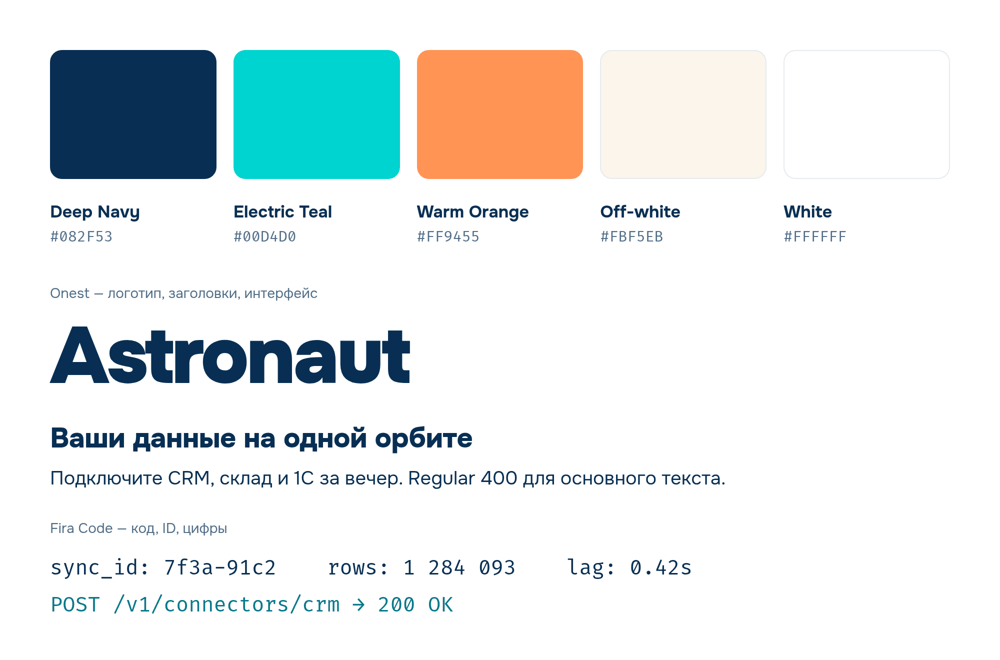

# Astronaut — шрифты и цвета



Картинка собрана из `specimen.html`: цвета и шрифты он берёт из `tokens.css`, команда рендера — в
его начале. Сменили палитру или шрифт — отрисуйте картинку заново этой командой.

## Шрифты

### Onest — основной

Логотип, заголовки, интерфейс, тексты. Геометрический гротеск, латиница и кириллица.
Надпись «Astronaut» во всех логотипах набрана им (Black 900), слоган — SemiBold 600.

| Где | Начертание |
|---|---|
| Логотип, крупные заголовки | Black 900 |
| Заголовки | Bold 700 / ExtraBold 800 |
| Слоган, кнопки, акценты | SemiBold 600 |
| Основной текст | Regular 400 / Medium 500 |

Файл: `fonts/Onest[wght].ttf` (вариативный, 100–900).
Google Fonts: https://fonts.google.com/specimen/Onest · лицензия OFL 1.1 (`fonts/OFL-Onest.txt`).

### Fira Code — моноширинный

Код, ID, ключи API, логи, цифры в таблицах — всё, что должно выравниваться по символам.
Тоже с кириллицей. С 03.11.2026 стоит вместо JetBrains Mono везде: в бренде, на фронтах, в PDF и
превью постов.

| Где | Начертание |
|---|---|
| Код, ID, логи | Regular 400 |
| Цифры в таблицах и метриках | Medium 500 |
| Даты на табло, номера этапов | SemiBold 600 |

Файл: `fonts/FiraCode[wght].ttf` (вариативный, 300–700: тоньше Light 300 и жирнее Bold 700 нет).
Google Fonts: https://fonts.google.com/specimen/Fira+Code · лицензия OFL 1.1 (`fonts/OFL-FiraCode.txt`).
Лигатуры (`->`, `!=`, `>=`) включены по умолчанию; в цифрах, датах и номерах их нет.

## Цвета

| Цвет | HEX | Роль |
|---|---|---|
| Deep Navy | `#082F53` | Текст, обводки, тёмный фон. Основной цвет бренда |
| Electric Teal | `#00D4D0` | Акцент: данные, кабель, ссылки, активные состояния |
| Warm Orange | `#FF9455` | Искра: CTA и точечные акценты. Использовать дозированно |
| Off-white | `#FBF5EB` | Тёплый светлый фон, подложки, тени скафандра |
| White | `#FFFFFF` | Основной светлый фон |

Пропорция на экране — примерно 60 / 25 / 10 / 5: белый и off-white фоны, navy текст,
teal акценты, orange только там, где нужно «подключение» или главное действие.

**03.11.2026 палитра стала светлее.** Прежняя — `#041A31`, `#00C4C0`, `#F88030`, `#F4ECE0`,
`#FDFDFD` — выглядела тяжёлой и мутной. Тон каждого цвета тот же, в OKLCH подняты светлота и
немного насыщенность. Контраст проверен: navy на белом 13,6:1, navy на оранжевом 6,2:1, на teal
7,3:1. Все SVG и PNG бренда перекрашены одним скриптом (`recolor.py` рядом, сдвиг цветов в
OKLab), ICO собраны заново, `specimen.png` отрисован заново.

Сменить палитру ещё раз:

```bash
uv run idea/skelet/brand/design/recolor.py --from <старые hex через запятую> --to <новые> \
  --exclude design/specimen.png idea/skelet/brand
```

Скрипт запускают один раз на смену: повторный прогон сдвинет цвета ещё раз. После него руками —
`tokens.css`, шкалы в `theme.ts`, этот файл, hex в стилях PDF-скриптов (`idea/*/utils/scripts`);
`specimen.png` — заново из `specimen.html` (подписи hex в нём тоже правятся руками).

## В коде

`tokens.css` — CSS-переменные цветов и шрифтов плюс `@font-face` для локальных файлов.

`theme.ts` — тема демо-сайта без фреймворка (просто данные; от Mantine отказались 04.11.2026, свой
UI-кит будет брать значения отсюда): шкалы по 10 оттенков `brand` (teal, основной), `accent` (orange),
`sand` (off-white), `dark` (navy для тёмной темы), шрифты, радиусы, тени и умолчания компонентов.
Фирменный цвет в каждой шкале стоит на индексе 6 (`primaryShade`) — его берут для заливки, так что
кнопки точно в цвет бренда.

`roles.css` — **роли дизайн-системы**, общий слой между палитрой и витринами (лендинг на Tailwind,
демо-сайт со своим UI-китом). Без фреймворка, только CSS-переменные: цвет (`--bg`, `--surface`, `--tint`, `--text`,
`--text-muted`, `--line`, `--accent`, `--accent-strong`, `--spark` и их `*-contrast`), тени
(`--elevation-card`, `--elevation-lift`), скругления (`--radius-chip|card|panel|pill`), `--ease-out-expo`,
фокус (`--focus-width`, `--focus-offset`). Компонент берёт роль, а не палитру и не HEX; новый оттенок —
`color-mix` от фирменных цветов здесь, чтобы его увидели обе витрины.

Слои, сверху вниз: `tokens.css` (палитра, шрифты) → `roles.css` (роли) → тема витрины
(`frontend/landing/src/app/styles/tokens.css` — имена утилит Tailwind; `theme.ts` — демо-сайт: шкалы, радиусы,
тени, кнопки-пилюли, карточки). Визуальные правила и компоненты — `frontend/landing/DESIGN.md`.

```html
<link rel="stylesheet" href="design/tokens.css">
<link rel="stylesheet" href="design/roles.css">
```

## Где используется

`brand/` — источник правды. `frontend/landing` и `frontend/demo-site` подключают отсюда симлинками логотипы, иконки,
`tokens.css`, `roles.css`, `fonts/` и `theme.ts` — правка здесь сразу видна в запущенной демке. Поэтому файлы
не переименовывайте и не перемещайте молча: ссылки сломаются (это ловит проверка стиля фронта).
Список ссылок — `frontend/demo-site/docs/codestyle/README.md`, раздел «Бренд».
